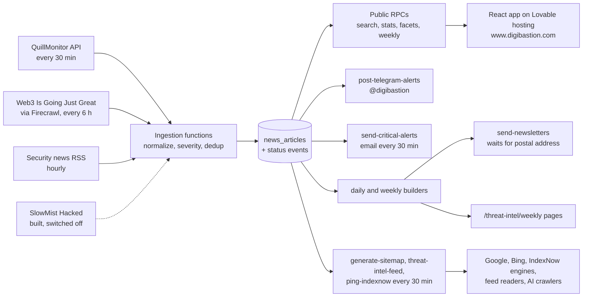

# Digibastion

Digibastion is a free Web3 security site. It tracks crypto hacks, exploits and
phishing from QuillMonitor and other public trackers, links every record to its
source, and sends alerts by email and on Telegram. It also has security
checklists, a two-minute OpSec self-check and practical guides. Teams that need
more can hire Digibastion for OpSec consulting or a full-stack security review,
or try Vantage (beta) to check their domain's security.

The site is https://www.digibastion.com. Digibastion was supported by the
[Ethereum Foundation Ecosystem Support Program in 2025](https://blog.ethereum.org/2025/12/02/allocation-q3-25#:~:text=Community%20%26%20education-,Digibastion,-Chirag%20Agrawal).

## Where to start

| You want to | Go to |
| --- | --- |
| Hear about new Web3 hacks and exploits | The [Threat Intel feed](https://www.digibastion.com/threat-intel), the Telegram channel [@digibastion](https://t.me/digibastion), or email alerts from the feed's Subscribe tab |
| Find your weak spots | The [OpSec self-check](https://www.digibastion.com/quiz), then the [security checklists](https://www.digibastion.com/) |
| Learn one topic properly | [Guides](https://www.digibastion.com/articles) and [tools](https://www.digibastion.com/tools) |
| See how incidents are tracked | The [methodology page](https://www.digibastion.com/threat-intel/methodology) and the [FAQ](https://www.digibastion.com/faq) |
| Get a team reviewed | [Services](https://www.digibastion.com/services) |
| Check a domain's DNS, email, TLS and Web3 trust setup | [Vantage](https://vantage.digibastion.com/) (beta; a separate app, not in this repo) |

## What is live

Threat Intel, at `/threat-intel`:

- A feed of Web3 incidents from QuillMonitor (checked every 30 minutes) and Web3
  Is Going Just Great (every 6 hours), plus security news from RSS feeds
  (hourly). Every record names and links its source.
- One record per incident. When two trackers report the same hack, Digibastion
  keeps one record and lists both sources. The matching rules are strict on
  purpose; [THREAT_INTEL_FEEDS.md](THREAT_INTEL_FEEDS.md) explains them.
- Severity from one rubric, mostly by reported loss: $50M or more is critical,
  $10M or more is high.
- Confirmed and unconfirmed status, shown exactly as QuillMonitor gives it.
  Digibastion does not verify incidents itself.
- A public [methodology page](https://www.digibastion.com/threat-intel/methodology)
  that explains all of the above.
- Email alerts for critical and high incidents that match your filters, checked
  every 30 minutes.
- The Telegram channel [@digibastion](https://t.me/digibastion). It posts new
  Web3 incidents from QuillMonitor, and a link to the weekly report every Monday.
- A weekly report page every Monday at `/threat-intel/weekly/<YYYY-MM-DD>`, with
  an archive at `/threat-intel/weekly`.
- A daily brief email and a weekly email. Both are built and tested but do not
  send yet. Sending starts once a postal address for the email footer is set
  (`NEWSLETTER_POSTAL_ADDRESS`), because anti-spam law (CAN-SPAM) requires one.
- RSS, Atom and JSON feeds of the newest incidents and weekly reports.

The rest of the site:

- 11 security checklists with 263 items. Progress is saved in your browser only.
- The OpSec self-check: eight questions drawn from 20 scenarios, scored on the
  server, with a leaderboard.
- 71 guides on wallets, phishing, DeFi, smart contracts, privacy, incident
  response and developer security.
- A tools directory with 27 entries in 9 categories, and a links directory.
- A FAQ page, service pages and a contact form.
- Private admin pages for analytics, scheduled jobs, ingestion health and API
  keys.

## How an incident reaches you

At 17 and 47 minutes past each hour (UTC), `fetch-quillmonitor-incidents` asks
QuillMonitor for new and changed incidents and stores them in the
`news_articles` table. The other importers do the same for their sources on
their own schedules. Each importer sets the severity, checks whether the
incident is already stored from another source, and on a strong match keeps one
record that lists both sources. The site reads that table directly, so the
incident page exists as soon as the row does. Within the next ten minutes,
`post-telegram-alerts` posts new QuillMonitor incidents to @digibastion,
`ping-indexnow` tells Bing and the other IndexNow search engines about the new
page, and `send-critical-alerts` emails subscribers whose filters match. The
feeds include it within 15 minutes and the sitemap within an hour, which is how
long each may be cached. On Monday the
weekly report gathers the week's incidents into one page.
[docs/PRODUCT_AND_ARCHITECTURE.md](docs/PRODUCT_AND_ARCHITECTURE.md) covers
every function and scheduled job.



## Run it locally

You need Node.js 22.12 or later and npm.

```bash
git clone https://github.com/Raiders0786/digibastion.git
cd digibastion
npm ci
npm run dev          # http://127.0.0.1:8080
```

The app talks to the production backend by default, using the public anon key
in `src/integrations/supabase/publicDefaults.ts`. Reading is fine. Do not test
forms that write data (subscribe, contact, quiz scores) against production.
Copy `.env.example` to `.env` and point `VITE_SUPABASE_URL` and
`VITE_SUPABASE_PUBLISHABLE_KEY` at your own Supabase project instead. Only
public browser values belong in `.env`.

| Command | What it does |
| --- | --- |
| `npm test` | Runs the Vitest suite once. |
| `npm run typecheck` | Type-checks the app (`tsconfig.app.json`) and the build scripts (`tsconfig.node.json`). |
| `npm run lint` | Runs ESLint. |
| `npm run build` | Builds the site into `dist/` and writes one HTML file per public page (see below). |
| `npm run check` | Typecheck, lint, tests and build, in that order. Run it before a pull request. |
| `npm run seo:generate` | Rewrites `public/sitemap.xml`, `public/sitemap-index.xml`, `public/llms.txt` and `public/llms-full.txt`. Run it after changing a route, guide or checklist; a test fails until you do. |

The build fetches the newest incidents and weekly reports from Supabase so it
can write a page for each. If Supabase cannot be reached, it skips those pages
with one warning and still succeeds. To build with no network at all, run
`PRERENDER_DYNAMIC=0 npm run build`. `PRERENDER=0` turns the per-page step off
entirely.

Edge functions are Deno code in `supabase/functions/`. You do not need Deno to
run the tests: the shared logic lives in plain TypeScript modules under
`supabase/functions/_shared/`, and Vitest tests them directly.

## How releases work

1. Changes land on `main` through pull requests.
2. The owner opens the Lovable project and runs the release prompt for that
   change, kept in `docs/LOVABLE_*_RELEASE.md`. Lovable applies the listed
   migrations, deploys the listed edge functions and runs the checks.
3. The owner clicks Publish in Lovable, which builds the site from `main` and
   puts it live.

Lovable sometimes commits to `main` itself, so pull before you branch. The
frontend is on Lovable static hosting with DNS at GoDaddy. The backend is
Supabase on Lovable Cloud; operators reach the database, functions, logs and
secrets through **View Backend** in Lovable, and there is no separate Supabase
dashboard login. `vercel.json` and `api/og-tags.ts` are left over from an
earlier Vercel setup and do nothing on the current host.

## Repository map

```text
src/pages/                  One file per route; src/App.tsx holds the route list
src/components/             Shared UI: navigation, checklist, quiz, news, share bar
src/lib/threatIntel/        Feed queries, incident display rules, official links
src/seo/                    Route metadata registry, site facts, FAQ, prerender
src/data/                   Checklists, guides, tools and links (plain data files)
src/integrations/supabase/  Browser client and generated database types
scripts/seo/                Build-time prerender and the seo:generate script
supabase/functions/         Deno edge functions, one folder each
supabase/functions/_shared/ Pure TypeScript shared by functions, app and tests
supabase/migrations/        Database schema, policies, RPCs and cron jobs
supabase/config.toml        Per-function gateway settings
edge/cloudflare-worker/     Optional Worker for per-URL HTML; inactive until DNS moves
public/                     Static files served as-is: robots.txt, sitemaps, llms.txt
docs/                       Architecture, release runbooks, roadmap, history
```

[docs/README.md](docs/README.md) lists every document.

## Contribute

Useful contributions include fixing a security recommendation, checking a guide
against primary sources, improving mobile or accessibility behavior, adding
tests, proposing a reputable threat source, or reproducing a bug. Start with
[CONTRIBUTING.md](CONTRIBUTING.md), and open an issue before any large or
architecture-changing work. The priorities are in
[docs/ROADMAP.md](docs/ROADMAP.md). Ideas and field reports are welcome in
[GitHub Discussions](https://github.com/Raiders0786/digibastion/discussions).

Report security vulnerabilities privately, as described in
[SECURITY.md](SECURITY.md).

## Community and support

- [GitHub issues](https://github.com/Raiders0786/digibastion/issues)
- [GitHub discussions](https://github.com/Raiders0786/digibastion/discussions)
- [Telegram alerts channel](https://t.me/digibastion)
- [Telegram community chat](https://t.me/digibastion_chat)
- [Maintainer on X](https://x.com/__Raiders)
- [Support the project](https://www.digibastion.com/support)

## License

This repository is source-available, not OSI-approved open source. The
[LICENSE](LICENSE) is the MIT text plus a Commons Clause restriction: you may
not sell the software, or paid services based on it, without permission.
Non-commercial use, changes and sharing are allowed under the full terms. For
commercial licensing, email `raiders@digibastion.com`.

The owner has not yet decided whether to keep Commons Clause or move to a
standard open-source license. Until then, the LICENSE file is what applies.
